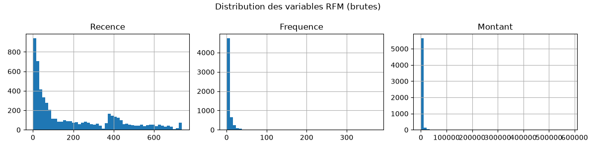
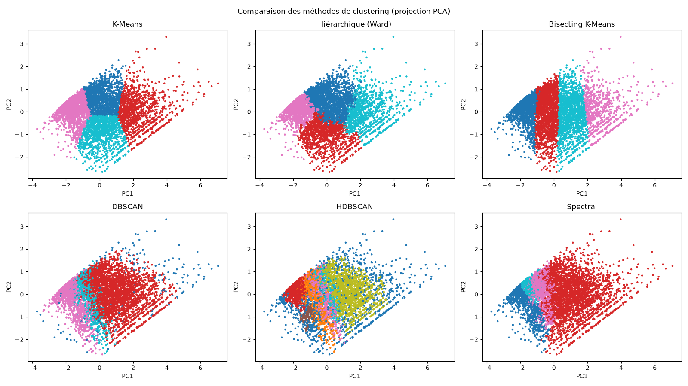
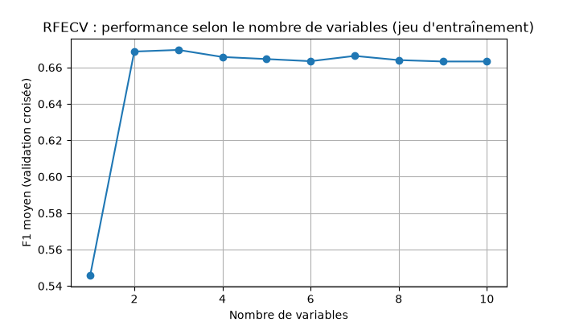

# Online Retail: customer segmentation and repurchase prediction
by Samuel-William Mpiana and Oeudire Doli

Course project for Applied Machine Learning (modules 3 to 5: feature selection, introduction to clustering, advanced clustering). It uses the [Online Retail dataset](https://archive.ics.uci.edu/dataset/352/online+retail) from UCI: 541,909 transaction lines from a UK online store, between 1 December 2010 and 9 December 2011.


## Objectives

| Task | What the project does |
|---|---|
| Customer clustering (RFM segmentation) | Part A: K-Means, hierarchical, DBSCAN, HDBSCAN, spectral |
| Repurchase probability classification | Part B: predict whether a customer buys again in the next 3 months |
| Ensemble methods | Random Forest and Gradient Boosting, tuned with nested cross-validation |

## Summary of results

- Customers are split into 4 segments with K-Means (k = 4). Of the six methods compared, it has the best silhouette, Davies-Bouldin and Calinski-Harabasz scores, and its segments are stable across bootstrap samples (ARI 0.91).
- Repurchase prediction reaches an F1 score of about 0.72 in cross-validation. Logistic regression and tuned Gradient Boosting perform at the same level, and the difference between them is not significant.
- Recency is the most important variable for predicting repurchase.

## Project structure

```
.
├── projet_online_retail.py      # full code, split into # %% cells
├── projet_online_retail.ipynb   # same code as a Jupyter notebook
├── rapport_projet.md            # detailed report (in French)
├── requirements.txt
├── figures/                     # 12 charts and 3 result tables (.csv)
└── online+retail/
    └── Online Retail.xlsx       # dataset, to download (see "Running the project")
```

Libraries: pandas, NumPy, Matplotlib, SciPy, scikit-learn (1.3 or later), openpyxl.

## Data cleaning

| Step | Reason |
|---|---|
| Remove rows without CustomerID (135,080 rows) | A customer cannot be segmented without an identifier |
| Remove exact duplicates | They distort amounts and frequencies |
| Set aside invoices starting with "C" | These are cancellations. They are reused as the `NbAnnulations` feature in Part B |
| Keep only Quantity > 0 and UnitPrice > 0 | Zero or negative values are errors or adjustments |
| Create `TotalPrice = Quantity x UnitPrice` | Amount of each line |

Result: 392,692 clean rows and 4,338 customers.

## Part A: RFM segmentation

### RFM variables

- Recency: days since the last purchase (reference date is the day after the last invoice)
- Frequency: number of distinct invoices
- Monetary: total amount spent

The distributions are very skewed: the median amount is £669 and the maximum is £280,206. Before clustering, the data goes through `log1p` to reduce the weight of very large customers, then `StandardScaler` so that the amount (in thousands) does not dominate the recency (in days).



### Choosing k for K-Means

| k | Inertia | Silhouette | Davies-Bouldin | Calinski-Harabasz |
|---|---|---|---|---|
| 2 | 6484 | 0.433 | 0.892 | 4367 |
| 3 | 4869 | 0.337 | 1.048 | 3625 |
| 4 | 3939 | 0.338 | 1.009 | 3328 |
| 5 | 3297 | 0.316 | 0.988 | 3193 |
| 6 to 8 | decreasing | about 0.30 to 0.31 | about 0.98 to 1.02 | decreasing |

k = 4 was chosen for three reasons. k = 2 scores best but only separates good customers from bad ones, which is of little use for marketing. The inertia curve bends around k = 3 to 4. Between k = 3 and k = 8, k = 4 has the best silhouette and a better Davies-Bouldin score than k = 3. Inertia always decreases as k grows, so it has to be read together with the other metrics and the business interpretation.


### Methods compared

- Hierarchical agglomerative (Ward), cut into 4 groups (dendrogram in `figures/03_dendrogramme.png`)
- Hierarchical divisive (Bisecting K-Means)
- DBSCAN with minPts = 6 (2 x 3 dimensions) and eps = 0.35, read from the k-distance curve (`figures/04_courbe_k_distance.png`)
- HDBSCAN with `min_cluster_size = 50`
- Spectral clustering on a graph of the 15 nearest neighbors

| Method | Clusters | Noise | Silhouette | Davies-Bouldin | Calinski-H. | Dunn | Stability (ARI) |
|---|---|---|---|---|---|---|---|
| K-Means | 4 | 0 | 0.338 | 1.009 | 3328 | 0.002 | 0.911 |
| Hierarchical (Ward) | 4 | 0 | 0.280 | 1.099 | 2740 | 0.007 | 0.376 |
| Bisecting K-Means | 4 | 0 | 0.282 | 1.175 | 3095 | 0.003 | 0.884 |
| DBSCAN | 3 | 175 | 0.175 | 1.689 | 2078 | 0.069 | 0.970 |
| HDBSCAN | 6 | 701 | 0.101 | 2.695 | 907 | 0.030 | 0.922 |
| Spectral | 4 | 0 | 0.178 | 1.466 | 1634 | 0.003 | 0.921 |

Metrics for DBSCAN and HDBSCAN are computed without the noise points. Stability is the mean ARI over 10 bootstrap samples.

What the results show:

- K-Means is best on the three main metrics, and its stability is good.
- Ward hierarchical clustering is unstable (ARI 0.38). On a continuous cloud of points, a small change in the data changes the order of the merges.
- DBSCAN and HDBSCAN have high Dunn and stability values, but they discard many customers as noise (up to 701) and have low silhouettes. Density-based methods work poorly when the density varies, which is the case here.
- The Dunn index is very low for every method. Customers form a continuum, not separate groups, so the minimum distance between neighboring clusters is close to zero. The segmentation cuts this continuum into useful zones.

The PCA projection shows the same thing: K-Means splits the cloud into 4 clear zones, while DBSCAN and HDBSCAN produce overlapping groups.



### The 4 segments

| Segment | Avg. recency (days) | Avg. frequency | Avg. amount (£) | Customers | Interpretation |
|---|---|---|---|---|---|
| 0 | 12 | 13.8 | 8,088 | 713 | Champions: recent, frequent, big spenders. Keep them with a loyalty program |
| 1 | 182 | 1.3 | 341 | 1,622 | Lost or inactive: one purchase about 6 months ago. Win-back campaign, or no investment |
| 2 | 18 | 2.2 | 557 | 837 | New or recent customers: potential to grow (welcome offer, second purchase) |
| 3 | 72 | 4.1 | 1,802 | 1,166 | Regular customers at risk: good customers with no purchase for over 2 months. First to re-engage |

Segment numbers (0 to 3) can change between scikit-learn versions. The profiles stay the same.

## Part B: Repurchase prediction

### Target

To avoid leaking information from the future, the history is cut at 9 September 2011:

- Observation period (before the cut): customer features are computed here.
- Prediction period (last 3 months): `Reachat = 1` if the customer bought at least once.

This gives 3,362 customers, with 57.1% repurchase and 42.9% no repurchase. There are 10 candidate features: `Recence`, `Anciennete`, `Frequence`, `Montant`, `PanierMoyen`, `QuantiteTotale`, `NbProduits`, `PrixMoyen`, `NbAnnulations`, `RoyaumeUni`.

### Feature selection

| Family | Method | Result |
|---|---|---|
| Filter | VarianceThreshold (threshold 0) | No constant variable, all 10 kept |
| Filter | Correlation | `Montant` and `QuantiteTotale` are almost redundant (r = 0.92). `Frequence` is strongly related to `NbProduits` (0.70) and `NbAnnulations` (0.69) |
| Filter | ANOVA (`f_classif`) | Most significant: `Recence`, `NbProduits`, `Frequence`, `NbAnnulations`, `Anciennete`. Not significant: `RoyaumeUni` (p = 0.76), `PanierMoyen` (p = 0.89) |
| Filter | Mutual information | Top: `Frequence`, `QuantiteTotale`, `Montant`, `NbProduits`. `RoyaumeUni` = 0 |
| Wrapper | RFE (logistic regression, 5 features) | `Recence`, `Frequence`, `Montant`, `PanierMoyen`, `NbProduits` |
| Wrapper | RFECV | 7 optimal features: `Recence`, `Frequence`, `Montant`, `PanierMoyen`, `QuantiteTotale`, `NbProduits`, `NbAnnulations` |
| Embedded | Lasso (alpha = 0.01) | Keeps `Recence` (strongest coefficient, negative), `Anciennete`, `NbProduits`, `PrixMoyen`, `NbAnnulations` |
| Embedded | Random Forest importances | Ranking of variables by tree splits |

The methods agree on one point: recency is the most important variable. The longer since the last purchase, the less likely the customer is to buy again. Frequency and product variety come next, and the country adds nothing. The final choice is the 7 RFECV features, since that method optimizes F1 directly in cross-validation.



### Model comparison

Each model is in a `StandardScaler -> model` pipeline, evaluated with stratified 5-fold cross-validation repeated 3 times (15 scores per model).

| Model | Precision | Recall | F1 (mean) | F1 (std) |
|---|---|---|---|---|
| Logistic regression | 0.729 | 0.702 | 0.715 | 0.015 |
| Decision tree | 0.708 | 0.707 | 0.705 | 0.021 |
| Random Forest | 0.694 | 0.698 | 0.696 | 0.014 |
| Gradient Boosting | 0.708 | 0.706 | 0.707 | 0.016 |


Paired Wilcoxon tests between the best model (logistic regression) and each of the others:

- vs. decision tree: p = 0.28, no significant difference
- vs. Random Forest: p = 0.0002, significant (logistic regression is better)
- vs. Gradient Boosting: p = 0.11, no significant difference

Effect of feature selection: F1 is 0.715 ± 0.013 with the 10 features and 0.715 ± 0.015 with the 7 selected ones. The Wilcoxon test gives p = 0.56, so there is no loss of performance with a simpler model.

### Tuned ensembles (nested cross-validation)

The inner loop (3 folds) uses `GridSearchCV` to look for the best hyperparameters. The outer loop (5 folds) measures the real performance of the tuned model without bias.

| Tuned ensemble | F1 (nested CV) |
|---|---|
| Random Forest | 0.709 ± 0.018 |
| Gradient Boosting | 0.716 ± 0.019 |

Tuning improves both models: Random Forest goes from 0.696 to 0.709, and Gradient Boosting from 0.707 to 0.716, which brings it level with logistic regression.

### Final model and test evaluation

Gradient Boosting (`learning_rate=0.1`, `max_depth=3`, `n_estimators=100`), trained on 80% of customers and tested on the remaining 20% (673 customers never seen).

| Class | Precision | Recall | F1 |
|---|---|---|---|
| No repurchase | 0.59 | 0.65 | 0.62 |
| Repurchase | 0.72 | 0.66 | 0.69 |
| Overall accuracy | | | 0.66 |


The test F1 (0.69) is a little lower than the cross-validation score (0.716). This is expected, since a single split varies more than an average over several folds. The script also prints each customer's repurchase probability (`predict_proba`). The most likely customers (probability above 0.97) bought very recently, very often and in many different products. The least likely (below 0.2) made a single purchase more than 150 days ago.

## Conclusions

1. Segmentation: K-Means on log-scaled, standardized RFM variables with k = 4 gives four stable and interpretable segments (champions, recent customers, regulars at risk, lost customers). It is the best of the six methods compared.
2. Repurchase: recency is the key factor. Logistic regression and tuned Gradient Boosting both reach an F1 of about 0.72, with no significant difference between them.
3. Ensembles: nested cross-validation improves Random Forest and Gradient Boosting. Purchase behavior is mostly explained by simple relationships, so the advantage of ensembles stays small.
4. Business use: both parts can be combined, for example by contacting first the "regulars at risk" with a medium repurchase probability, where a reminder is most likely to have an effect.

## Limitations

- The data covers only one year, and the target looks only at the following 3 months.
- The cutoff date falls just before the holiday season, so there may be a seasonal effect.
- Customers without an identifier (25% of the rows) are excluded from the analysis.

## Running the project

1. Download `Online Retail.xlsx` from the [UCI page](https://archive.ics.uci.edu/dataset/352/online+retail) and place it in a folder named `online+retail/` next to the script.
2. Install the dependencies and run the script:

```bash
pip install -r requirements.txt
python projet_online_retail.py
```

The notebook `projet_online_retail.ipynb` contains the same code. A full run takes about 5 minutes, mostly for reading the Excel file and the nested cross-validation. All figures are saved in `figures/`.
