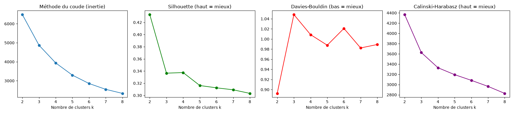
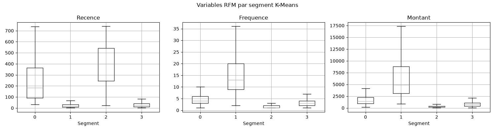
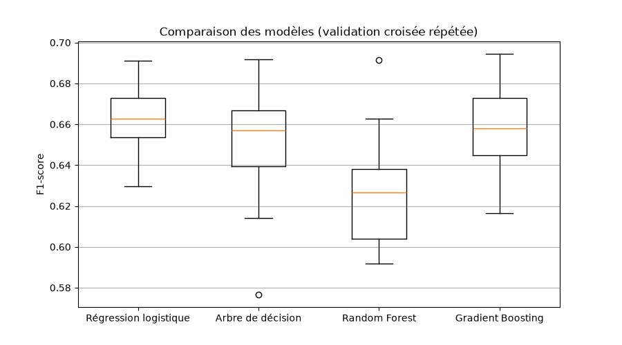
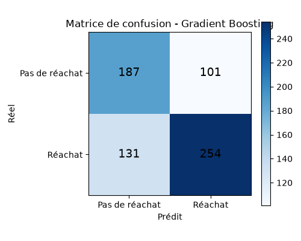

# Online Retail: Customer Segmentation and Repurchase Prediction

Customer behavior analysis on the [Online Retail dataset (UCI)](https://archive.ics.uci.edu/dataset/352/online+retail), a UK online store with 541,909 transaction lines from 01/12/2010 to 09/12/2011.

Course project for *Applied Machine Learning* (Modules 3, 4 and 5: feature selection, introduction to clustering, advanced clustering techniques).

## Goals

| Task | What the project does |
|---|---|
| Customer clustering (RFM segmentation) | Part A: K-Means, hierarchical, DBSCAN, HDBSCAN, spectral |
| Repurchase probability classification | Part B: predict whether a customer buys again in the next 3 months |
| Ensemble methods to improve prediction | Random Forest and Gradient Boosting, tuned with nested cross-validation |

## Tech stack

- **Python** with `pandas`, `numpy`, `matplotlib`, `scipy`, `scikit-learn` (>= 1.3), `openpyxl`
- Delivered as a script with `# %%` cells and a Jupyter notebook

## Project structure

```
module_ML/
├── projet_online_retail.py      # full code, split into # %% cells
├── projet_online_retail.ipynb   # same code as a Jupyter notebook
├── rapport_projet.md            # full report (French)
├── requirements.txt
├── figures/                     # 12 charts (01_... to 12_...) + result tables (.csv)
└── online+retail/
    └── Online Retail.xlsx       # dataset (see "How to run")
```

## Data cleaning

Raw data: **541,909 rows**, one per product line on an invoice.

| Step | Reason |
|---|---|
| Drop rows without `CustomerID` (135,080 rows) | Unknown customers cannot be segmented |
| Drop exact duplicates | They would distort amounts and frequencies |
| Set aside invoices starting with "C" | These are cancellations, reused as the `NbAnnulations` feature in Part B |
| Keep only `Quantity > 0` and `UnitPrice > 0` | Zero or negative values are errors or adjustments |
| Create `TotalPrice = Quantity x UnitPrice` | Amount of each line |

**Result:** 392,692 clean rows and **4,338 customers**.

## Part A: RFM segmentation (clustering)

### RFM variables
- **Recency**: days since the last purchase
- **Frequency**: number of distinct invoices
- **Monetary**: total amount spent

The distributions are very skewed (median amount £669, maximum £280,206), so the data goes through `log1p` and then `StandardScaler` before clustering.

### Choosing k for K-Means



| k | Inertia | Silhouette | Davies-Bouldin | Calinski-Harabasz |
|---|---|---|---|---|
| 2 | 6484 | **0.433** | **0.892** | **4367** |
| 3 | 4869 | 0.337 | 1.048 | 3625 |
| **4** | **3939** | **0.338** | **1.009** | 3328 |
| 5 | 3297 | 0.316 | 0.988 | 3193 |

**k = 4 was chosen.** k = 2 scores best but only separates "good" from "bad" customers, which is of little use for marketing. The inertia curve has an elbow around k = 3-4, and between k = 3 and 8, k = 4 has the best silhouette.

### Methods compared

| Method | Clusters | Noise | Silhouette | Davies-Bouldin | Calinski-H. | Dunn | Stability (ARI) |
|---|---|---|---|---|---|---|---|
| **K-Means** | 4 | 0 | **0.338** | **1.009** | **3328** | 0.002 | 0.911 |
| Hierarchical (Ward) | 4 | 0 | 0.280 | 1.099 | 2740 | 0.007 | 0.376 |
| Bisecting K-Means | 4 | 0 | 0.282 | 1.175 | 3095 | 0.003 | 0.884 |
| DBSCAN | 3 | 175 | 0.175 | 1.689 | 2078 | **0.069** | **0.970** |
| HDBSCAN | 6 | 701 | 0.101 | 2.695 | 907 | 0.030 | 0.922 |
| Spectral | 4 | 0 | 0.178 | 1.466 | 1634 | 0.003 | 0.921 |

*DBSCAN and HDBSCAN metrics are computed without noise points. Stability is the mean ARI over 10 bootstrap samples.*

**Takeaways**
- K-Means is best on the three main metrics and is stable (0.91).
- Ward hierarchical clustering is unstable (ARI 0.38).
- DBSCAN and HDBSCAN have high Dunn and stability but discard many customers as noise (up to 701) and have weak silhouettes, because the data has variable density.
- Dunn is very low for every method: customers form a **continuum**, not well-separated islands.

### The 4 segments (K-Means, k = 4)



| Segment | Avg. recency (days) | Avg. frequency | Avg. amount (£) | Customers | Interpretation |
|---|---|---|---|---|---|
| 0 | 12 | 13.8 | 8,088 | 713 | **Champions**: recent, frequent, big spenders. Retain with a VIP program. |
| 1 | 182 | 1.3 | 341 | 1,622 | **Lost / inactive**: one purchase about 6 months ago. Win-back campaign or no investment. |
| 2 | 18 | 2.2 | 557 | 837 | **New / recent customers**: potential to develop (welcome offer, second purchase). |
| 3 | 72 | 4.1 | 1,802 | 1,166 | **Regular customers at risk**: good customers silent for 2+ months. Re-engage first. |

> Segment numbers (0-3) can change between scikit-learn versions. The profiles stay the same.

## Part B: Repurchase prediction (classification)

### Target
To avoid data leakage, the history is cut at **9 September 2011**:
- **Observation period** (before the cut): customer features are computed here.
- **Prediction period** (last 3 months): `Repurchase = 1` if the customer bought at least once.

This gives **3,362 customers**: 57.1% repurchase, 42.9% no repurchase.

Candidate features (10): `Recence`, `Anciennete`, `Frequence`, `Montant`, `PanierMoyen`, `QuantiteTotale`, `NbProduits`, `PrixMoyen`, `NbAnnulations`, `RoyaumeUni`.

### Feature selection

| Family | Method | Result |
|---|---|---|
| Filter | VarianceThreshold | No constant variable, all 10 kept |
| Filter | Correlation | `Montant` and `QuantiteTotale` nearly redundant (r = 0.92) |
| Filter | ANOVA | `RoyaumeUni` (p = 0.76) and `PanierMoyen` (p = 0.89) not significant |
| Filter | Mutual information | `Frequence`, `QuantiteTotale`, `Montant`, `NbProduits` on top; `RoyaumeUni` = 0 |
| Wrapper | RFE (logistic regression, 5 features) | `Recence`, `Frequence`, `Montant`, `PanierMoyen`, `NbProduits` |
| Wrapper | **RFECV** | **7 optimal features** |
| Embedded | Lasso (alpha = 0.01) | Keeps `Recence`, `Anciennete`, `NbProduits`, `PrixMoyen`, `NbAnnulations` |
| Embedded | Random Forest importances | Feature ranking from tree splits |

**Recency is the most important variable**: the longer since the last purchase, the less likely the customer buys again. Country adds nothing. The final choice is the **7 RFECV features**.

### Model comparison


Each model is in a `StandardScaler -> model` pipeline, evaluated with stratified 5-fold CV repeated 3 times (15 scores per model).

| Model | Precision | Recall | F1 mean | F1 std |
|---|---|---|---|---|
| **Logistic Regression** | **0.729** | 0.702 | **0.715** | 0.015 |
| Decision Tree | 0.708 | 0.707 | 0.705 | 0.021 |
| Random Forest | 0.694 | 0.698 | 0.696 | 0.014 |
| Gradient Boosting | 0.708 | 0.706 | 0.707 | 0.016 |

### Statistical tests (paired Wilcoxon, vs. logistic regression)
- vs. Decision Tree: p = 0.28, no significant difference
- vs. Random Forest: p = 0.0002, significant (logistic regression is better)
- vs. Gradient Boosting: p = 0.11, no significant difference

**Effect of feature selection:** F1 = 0.715 with 10 features and 0.715 with 7 features (p = 0.56), so there is no performance loss with a simpler model.

### Tuned ensembles (nested cross-validation)
- **Inner loop** (3 folds): `GridSearchCV` tunes the hyperparameters.
- **Outer loop** (5 folds): unbiased performance estimate.

| Tuned ensemble | F1 (nested CV) |
|---|---|
| Random Forest | 0.709 ± 0.018 |
| **Gradient Boosting** | **0.716 ± 0.019** |

Tuning improves both (Random Forest 0.696 to 0.709, Gradient Boosting 0.707 to 0.716).

### Final model and test evaluation


**Gradient Boosting** (`learning_rate=0.1`, `max_depth=3`, `n_estimators=100`), trained on 80% and tested on 20% (673 unseen customers):

| Class | Precision | Recall | F1 |
|---|---|---|---|
| No repurchase | 0.59 | 0.65 | 0.62 |
| Repurchase | 0.72 | 0.66 | 0.69 |
| **Overall accuracy** | | | **0.66** |

The test F1 (0.69) is a bit lower than the CV score (0.716), as expected from a single split. The script also outputs each customer's repurchase probability (`predict_proba`).

## Conclusions

1. **Segmentation:** K-Means on log-scaled, standardized RFM with k = 4 gives stable, interpretable segments (champions, recent, at-risk regulars, lost). It was the best of the 6 methods compared.
2. **Repurchase:** recency is the key factor. Logistic regression and tuned Gradient Boosting both reach about F1 = 0.72, with no significant difference.
3. **Ensembles:** nested CV improves Random Forest and Gradient Boosting, but the gain over a simple model is modest.
4. **Business use:** combine both parts, for example by targeting "regulars at risk" with a medium repurchase probability first, where a reminder has the most impact.

## Limitations
- Only 1 year of data, and the target covers only the next 3 months.
- The cutoff date is just before the holidays, so there may be a seasonal effect.
- Customers without an ID (about 25% of rows) are excluded.

## How to run

1. Download `Online Retail.xlsx` from the [UCI repository](https://archive.ics.uci.edu/dataset/352/online+retail) and place it in `online+retail/`.
2. Install dependencies and run:

```bash
pip install -r requirements.txt
python projet_online_retail.py   # or open projet_online_retail.ipynb in Jupyter
```

All figures are saved in `figures/`. Total run time is about 5 minutes (reading the Excel file and the nested CV are the slowest steps).
